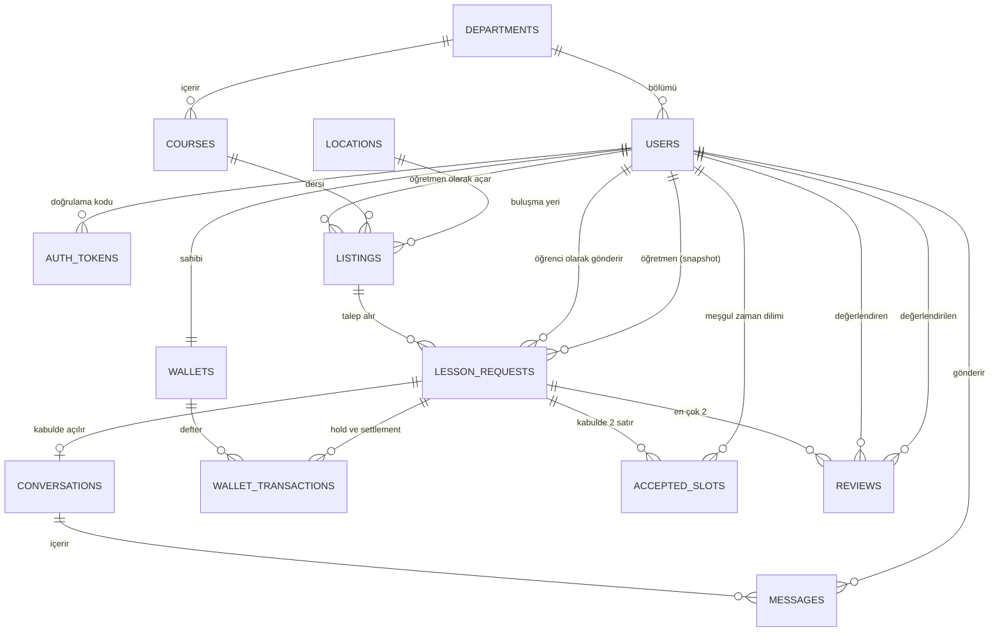
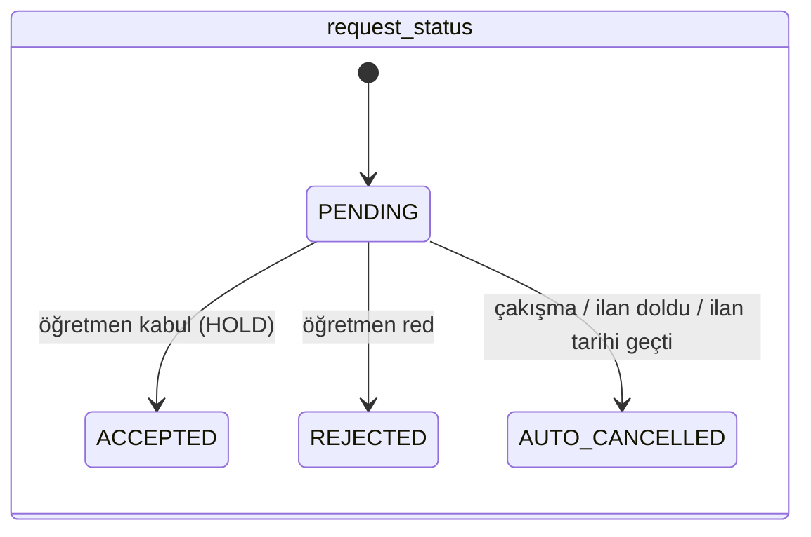
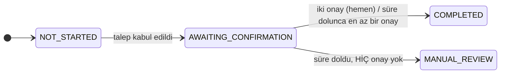

# StudyCo ER diyagramı (düzeltilmiş)

Şartnamedeki taslaktan farklar: (1) `users` ile `lesson_requests` ve `reviews` arasında **iki ayrı** ilişki var
(öğrenci/öğretmen, değerlendiren/değerlendirilen); (2) yeni tablo `accepted_slots` (çakışma kısıtı için);
(3) `lesson_requests.teacher_id` ve `time_range` ilandan kopyalanan değiştirilemez snapshot alanlarıdır.

## Durum makineleri

Onay penceresi: `[ders bitişi, ders bitişi + 24 saat]`. Pencere dışı onay reddedilir.
Süre dolunca **en az bir** taraf onaylamışsa token öğretmene aktarılır (`settlement_basis` neyin
dayanak olduğunu kaydeder); kimse onaylamamışsa `MANUAL_REVIEW` ve token bloke kalır.
